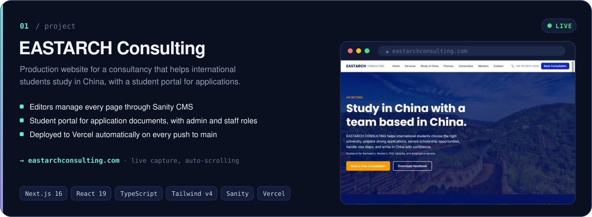
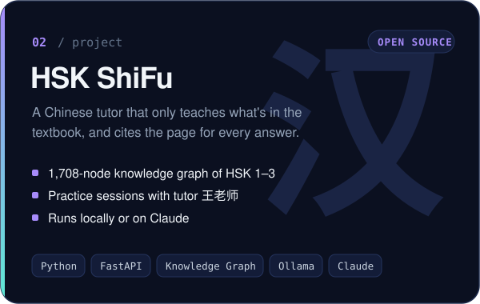
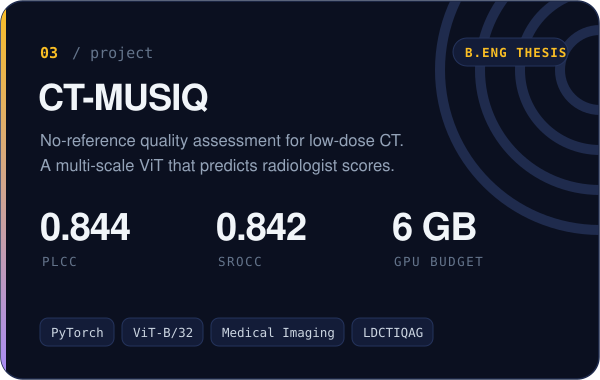
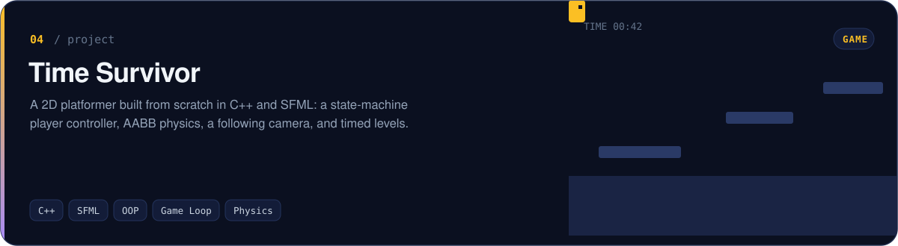
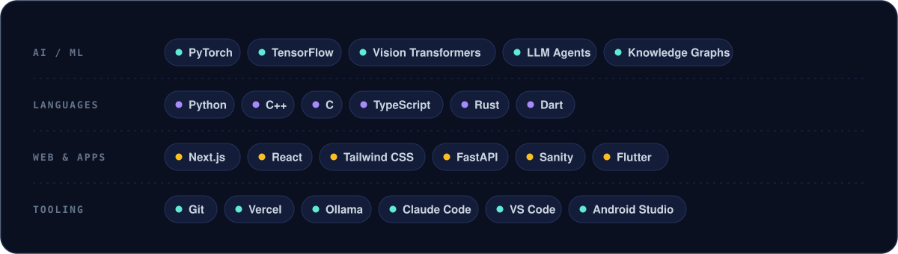

  

  <a href="https://www.linkedin.com/in/msamiulhasnat/"><b>LinkedIn</b></a>
  &nbsp;&nbsp;·&nbsp;&nbsp;
  <a href="mailto:samiulhsnt2016@gmail.com"><b>Email</b></a>
  &nbsp;&nbsp;·&nbsp;&nbsp;
  <a href="https://twitter.com/MSamiulHasnat"><b>X / Twitter</b></a>
  &nbsp;&nbsp;·&nbsp;&nbsp;
  <a href="https://www.facebook.com/m.samiul.hsnt"><b>Facebook</b></a>

 

I'm a Master's student in **Computer Science & Technology** at **Dalian University of Technology**. Before that I studied Software Engineering at **Sichuan University**, where my thesis taught a vision transformer to judge the quality of low-dose CT scans the way a radiologist would.

I work across the stack, from training models on a 6 GB GPU to running production websites. Lately that means **LLM agents grounded in knowledge graphs**, **medical imaging**, and **network science**.

> **Open to** research collaborations, AI and computer vision projects, and internships.

 

## Selected work

  
  

▶ <a href="https://youtu.be/GqKTSETgcbw">Watch the Time Survivor gameplay demo</a>

## Toolbox

  

  

